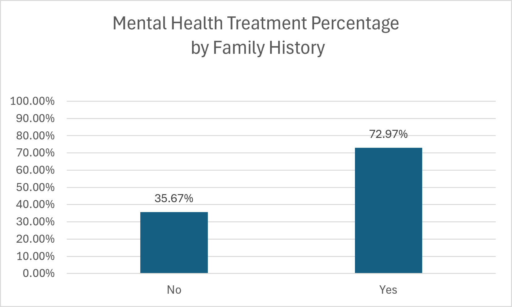

# Mental Health Treatment Analysis

## Project Objective
This project analyzes factors linked with mental health treatment-seeking behavior using survey data from Kaggle.

## Tools Used
- Excel
- PivotTables
- Data Cleaning
- Data Visualization
- GitHub

## Data Cleaning Process
- Removed 2,313 duplicate records
- Checked key variables for missing values
- Verified significant analysis columns contained valid responses

## Key Analyses

### 1. Growing Stress vs Treatment
Analyzed whether increasing stress levels were linked with mental health treatment-seeking behavior.

### 2. Mood Swings vs Treatment
Evaluated and compared mood swing categories against treatment-seeking behavior patterns.

### 3. Family History vs Treatment
Analyzed whether individuals with a family history of mental illness were more likely to seek treatment.

## Key Findings
- Individuals disclosing growing stress showed higher treatment-seeking behavior.
- Mood swing categories showed moderately resembling treatment-seeking patterns.
- Individuals with a family history of mental illness were substantially more likely to seek treatment.

## Files Included
- Excel workbook with PivotTables and analysis
- Data visualizations/charts
- Project documentation and insights

## Conclusion
This project demonstrates beginner-level data analysis skills using Excel, PivotTables, data cleaning techniques, and visualization methods to explore mental health treatment-seeking behavior.

## Sample Visualization

### Family History vs Mental Health Treatment

## Dataset Source and Attribution

**Dataset:** Mental Health Dataset
**Creator:** bhavikjikadara (Kaggle)
**Source:** https://www.kaggle.com/datasets/bhavikjikadara/mental-health-dataset
**License:** [Creative Commons Attribution 4.0 International (CC BY 4.0)](https://creativecommons.org/licenses/by/4.0/)

**Modifications:** Cleaned the dataset in Microsoft Excel, removed 2,313 duplicate records, created PivotTables, calculated treatment percentages, and developed visualizations to explore mental health treatment-seeking patterns.

This is an independent educational portfolio project and is not endorsed by the original dataset creator.
